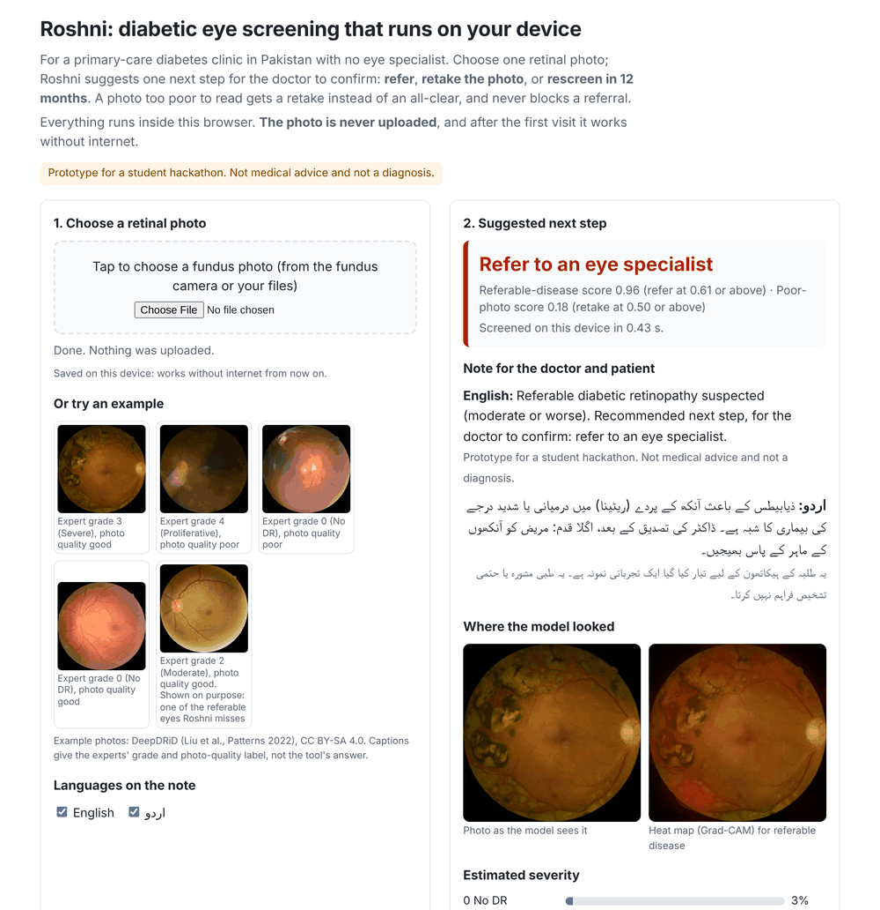

# Roshni: open, offline diabetic eye triage for primary-care clinics in Pakistan

**Track:** Health
**Team:** Varun Bajpai (India), Laziza Farrukhovna (Uzbekistan), Zainab Jamshed (Pakistan)
**Try it:** https://macvxace.github.io/roshni/web/ · **Code:** https://github.com/MACVXACE/roshni

> This project is a prototype and is not medical advice.

**Main takeaway:** Roshni ranks disease well at unseen hospitals (AUC 0.911), but each clinic must re-set its cut-off locally, which an open tool allows.

<!-- Generated from README.template.md by fill_report.py. Edit the template, not this file. Numbers come only from results/. -->

## The problem
Pakistan has the world's highest diabetes prevalence: 31.4% of adults, about 34.5 million people, and in Pakistani studies about 29% of people with diabetes had diabetic retinopathy (9% sight-threatening). It is treatable if caught early, but screening is concentrated in eye hospitals: Pakistan has about 15 ophthalmologists per million people, mostly in cities. Travel is costly and harder for women, and in one clinic study over 70% of long-standing diabetes patients had never had a retinal check.

## What we built
**User:** a doctor or nurse in a Pakistani primary-care diabetes clinic with a retinal camera but no eye specialist. **In:** one retinal photo. **Out:** one next step for the doctor to confirm: **REFER** (moderate or worse, grade 2 to 4), **RETAKE** (too unclear to rule disease out) or **RESCREEN** in 12 months.
**Safety rule:** a photo judged too poor to read gets a retake instead of an all-clear, and never blocks a referral. It also shows the estimated grade, a heat map and a note in English and Urdu.

## What we added
Our own idea (track 4.1.4).

- **What already exists:** FDA-cleared LumineticsCore and EyeArt, and Medios AI (offline, smartphone camera, India): all commercial and closed (appendix); UK estimates for AI graders were GBP 0.35 to 3.02 per patient (NICE 2021).
- **What we add:** an open, safety-first version anyone can re-test: thresholds frozen before testing, failures published, a retake rule that never blocks a referral, a pre-planned stress test, and a browser demo that keeps the photo on the device and works offline (about 0.15 s per photo on a CPU, with no graphics card).
- **Own question:** does the photo-quality check stop false all-clears? On 400 external photos, referable photos given an all-clear fell from 81 to 46 (severe or proliferative: 13 to 4), costing 154 retakes.
- **New source:** trained on rural India (APTOS 2019), tested once on unseen Chinese hospital photos (DeepDRiD).

## How it works
- **Data:** APTOS 2019, 3,662 photos graded 0 to 4 (Aravind Eye Hospital, India), split by grade into 2,886 training, 424 validation and 352 test photos, with 1,457 near-duplicate pairs kept on one side of the split. External: 1,600 DeepDRiD photos from 400 patients with expert quality labels.
- **Model:** EfficientNet-B0 (ImageNet weights), fine-tuned for 12 epochs at 384 px; referable score = probability of grade 2 or worse.
- **Frozen before testing:** the referral threshold (0.614) was set for 90% sensitivity on validation; the quality check (logistic regression on image features, cut-off 0.50) was trained only on DeepDRiD's 1,200 training photos.
- **Baselines:** colour histogram, and untuned pretrained features, each + logistic regression, thresholded the same way.

## Results
Held-out APTOS test (352 photos, 152 referable) and external DeepDRiD:

| Model | AUC (95% CI) | Sensitivity | Specificity | Missed (FN) | False alarms (FP) |
|---|---|---|---|---|---|
| Colour histogram + logistic regression | 0.848 (0.809 to 0.886) | 84.2% | 72.0% | 24 | 56 |
| Pretrained features, not fine-tuned + logistic regression | 0.968 (0.951 to 0.981) | 83.6% | 93.5% | 25 | 13 |
| Fine-tuned efficientnet_b0 | 0.978 (0.965 to 0.988) | 84.2% | 94.0% | 24 | 12 |
| Fine-tuned, external DeepDRiD (China) | 0.911 (0.897 to 0.925) | 56.1% | 97.2% | 307 | 25 |

- **By severity (APTOS test):** 17 of 17 severe and 29 of 33 proliferative photos were referred.
- **External photos:** at the frozen cut-off sensitivity fell to 56.1% though AUC stayed 0.911: the ranking carried over, the cut-off did not. Re-set on about 200 local labelled photos, it gave 92.8% sensitivity and 74.1% specificity (post-hoc; appendix).
- **v2, more cameras (pre-registered):** adding 12,522 photos from 147 hospitals raised DeepDRiD sensitivity to 94.9% (false all-clears 46 → 3) but cut specificity to 78.2%, with 81 near-copies of DeepDRiD photos among them: it failed 2 of 5 pre-set tests, so v1 stays the demo model (appendix).
- **Worse photos (stress test):** on external photos sensitivity fell to 10.6% at worst (blur, strong), yet with the quality check false all-clears stayed at 51 or fewer, against up to 161 without it; strong compression cut specificity to 35.9% (appendix).
- **Where it fails:** Photo 4 in results/missed_external.png (expert grade 3): we think it was missed because darkness and haze hide severe lesions in a poor-quality scan. Photo 8 (expert grade 2): we think bottom glare and tiny red lesions blending into clear vessels hid the disease.
- **What we learned:** It surprised us how sharply sensitivity dropped on new hospital cameras (56.1% versus 84.2%), while our quality check proved essential on degraded scans. Next time, we would calibrate the referral threshold on local clinic photos first and train on diverse cameras.

**Limitations.** Not tested on Pakistani patients or low-cost cameras; the stress test only imitates worse photos. APTOS grades come from single graders. Unlike commercial tools, we do not detect macular oedema, use one photo per eye and have no prospective trial. No age or sex is recorded; sensitivity differs by hospital source (appendix).

## What we'd do next
1. If access is granted, score the frozen tool once on the expert-graded Pakistani dataset registered at Al-Ibrahim Eye Hospital, Karachi (NCT06287645), re-setting the cut-off only on a separate local sample.
2. Test it camera by camera with low-cost cameras used in Pakistan, then run a costed one-clinic pilot measuring retakes, referrals and attendance.

## Sources
- IDF Diabetes Atlas, Pakistan: https://diabetesatlas.org/data-by-location/country/pakistan
- Mumtaz et al. 2018, diabetic retinopathy in Pakistan, systematic review: https://pjms.com.pk/index.php/pjms/article/view/13819
- Ophthalmologists per million in Pakistan (The News, 2026): https://www.thenews.pk/print/1422954-rising-cataract-burden-outpaces-pakistan-s-healthcare-capacity
- Sightsavers 2021, diabetic retinopathy services in Pakistan (primary level, cities, barriers for women): https://www.sightsavers.org/blogs/2021/06/diabetic-retinopathy-in-pakistan
- Shah et al. 2019, screening policy in Pakistani eye hospitals: https://www.ijo.cn/gjyken/article/pdf/20190517
- Siddiqui, Zafar and Qazi 2023, AI and the future of healthcare in Pakistan (J Pak Med Assoc): https://jpma.org.pk/index.php/public_html/article/view/10917/2701
- Pakistan public primary-care spending (World Bank, Health Financing System Assessment): https://openknowledge.worldbank.org/bitstreams/716ee589-8e2b-4c9c-9759-b2d45c68ee01/download
- Barriers to eye care in Pakistan (Malik et al. 2025): https://www.ncbi.nlm.nih.gov/pmc/articles/PMC12260732/
- Pakistani expert-graded retinal dataset registered on ClinicalTrials.gov (NCT06287645; site: Al-Ibrahim Eye Hospital, Karachi): https://clinicaltrials.gov/study/NCT06287645
- NICE MIB265 (2021), AI technologies for detecting diabetic retinopathy (cost per patient): https://www.nice.org.uk/advice/mib265/chapter/summary
- Jawa et al. 2016, integrated primary-care model for DR detection in Pakistan (Pak J Med Sci; cites the 223-patient clinic study): https://pjms.com.pk/index.php/pjms/article/view/10955
- Ahsan et al. 2021, one-window diabetes eye care facility at Al-Ibrahim Eye Hospital (Pak J Med Sci): https://pjms.org.pk/index.php/pjms/article/download/3946/1100
- Topcon TRC-NW400 camera about US$15,000 to 22,000; IDx-DR per-image fee not public (AAFP 2020): https://www.aafp.org/pubs/afp/issues/2020/0301/p307.html
- Google's Thailand deployment (MIT Technology Review 2020): https://www.technologyreview.com/2020/04/27/1000658/google-medical-ai-accurate-lab-real-life-clinic-covid-diabetes-retina-disease/amp/ and (TechCrunch 2020): https://techcrunch.com/2020/04/27/google-medical-researchers-humbled-when-ai-screening-tool-falls-short-in-real-life-testing/
- LumineticsCore (IDx-DR) FDA 510(k) summary K203629: https://www.accessdata.fda.gov/cdrh_docs/pdf20/K203629.pdf
- EyeArt FDA 510(k) summary K200667: https://www.accessdata.fda.gov/cdrh_docs/pdf20/K200667.pdf
- LumineticsCore pivotal trial (Abramoff et al. 2018): https://www.nature.com/articles/s41746-018-0040-6
- EyeArt pivotal trial (Ipp et al. 2021): https://pubmed.ncbi.nlm.nih.gov/34779843/
- Medios AI, offline smartphone screening in India (Natarajan et al., JAMA Ophthalmology 2019): https://pubmed.ncbi.nlm.nih.gov/31393538/ and in Dominica (Kemp et al., BMJ Open Ophthalmology 2023): https://bmjophth.bmj.com/content/8/1/e001491
- APTOS 2019 Blindness Detection: https://www.kaggle.com/c/aptos2019-blindness-detection
- DeepDRiD (Liu et al., Patterns 2022): https://github.com/deepdrdoc/DeepDRiD
- OIA-DDR (Li et al., Information Sciences 2019; used only in the v2 experiment): https://github.com/nkicsl/DDR-dataset and https://doi.org/10.1016/j.ins.2019.06.011
- Pretrained model: EfficientNet-B0 with ImageNet weights (torchvision `IMAGENET1K_V1`): https://docs.pytorch.org/vision/stable/models/generated/torchvision.models.efficientnet_b0.html; EfficientNet paper (Tan and Le 2019): https://arxiv.org/abs/1905.11946
- Grad-CAM (Selvaraju et al. 2017): https://arxiv.org/abs/1610.02391
- Libraries: PyTorch https://pytorch.org, scikit-learn https://scikit-learn.org, pandas https://pandas.pydata.org, Pillow https://python-pillow.org, matplotlib https://matplotlib.org, Gradio https://www.gradio.app, ONNX Runtime and ONNX Runtime Web https://onnxruntime.ai, NumPy https://numpy.org, scikit-image (sample photos in `non_retinal_check.py`) https://scikit-image.org
- Tools for tests and the video only: Playwright https://playwright.dev, FFmpeg https://ffmpeg.org, Node.js https://nodejs.org
- AI tools: Claude (Anthropic), https://claude.ai: code, experiment design, research checks and write-up drafting; Claude Fable 5.2 (Anthropic): redesign of the demo page

---

## Appendix: technical details

**How this maps to the Round 1 rubric** (highschoolhackathon.org/judges)

| Criterion (points) | Evidence in this project |
|---|---|
| Technical execution (30) | A demo that runs end to end in the browser and offline, with the browser model checked against PyTorch; EfficientNet-B0 fine-tuned with a near-duplicate-safe split; two baselines; threshold frozen on validation; held-out test; untouched external set from another country with patient-level confidence intervals |
| Originality (20) | Our own question (does a quality check stop false all-clears?); a retake rule that never blocks a referral; a proven screening workflow rebuilt in the open and re-settable by each clinic; tested on deliberately worse photos and on pictures that are not retinal photos |
| Impact and track fit (20) | A named user and moment in Pakistani primary care; three actions a clinic can act on; sourced diabetes and eye-workforce figures for Pakistan; no server, account or licence; a note in Urdu checked by a native speaker |
| Testing and honesty (15) | Missed cases and false alarms reported separately; named missed photos; a stress test planned before results; the drop at new hospitals reported (56.1%); a pre-registered experiment (v2) reported although it failed; post-hoc analyses labelled as post-hoc; a real-world yardstick that none of our settings meets yet |
| Communication (15) | A screenshot and one main takeaway at the top; three actions (refer, retake, rescreen); a two-minute video of the real demo; every number generated from `results/` |

**What already exists, and where Roshni differs** (from FDA summaries and published studies; their accuracy comes from prospective studies, ours from public photos)

| | LumineticsCore (IDx-DR) | EyeArt | Medios AI | Roshni |
|---|---|---|---|---|
| Who takes the photo | Primary-care staff | Primary-care or eye-care staff | A minimally trained health worker | Primary-care doctor or nurse |
| Camera | 2 photos per eye, Topcon NW400 only | 2 photos per eye, named Canon cameras | Remidio smartphone-based camera | 1 photo, no camera model required; not yet tested on low-cost cameras |
| Referral line | More than mild DR, including macular oedema | Moderate or worse, or macular oedema | More than mild DR, with or without macular oedema | Moderate or worse (grade 2 to 4); no macular oedema |
| Poor photo | "Insufficient image quality" | "Ungradable" | Not stated in the studies we read | Retake, or refer if disease is already visible |
| Where it runs | Remote servers | Remote servers | Offline, on the camera's smartphone | A web browser, offline after the first visit; or a CPU alone (about 0.15 s per photo on a CPU, with no graphics card) |
| Code and model | Commercial | Commercial | Proprietary | Open |
| Evidence | Prospective trial: 900 patients, 10 primary-care sites | Prospective trial: 893 patients, 15 sites | 213 participants in India (sensitivity 100%, specificity 88.4%); in real-world use in Dominica, 77.5% and 91.5% | Retrospective: held-out and external public photos, plus a stress test; not tested in Pakistan |

**Who would test it first (a hypothesis, not a finding)**

Al-Ibrahim Eye Hospital, Karachi, runs a one-window diabetes eye facility that includes fundus photography, and is registering an expert-graded Pakistani retinal dataset (NCT06287645). For a first test to be worthwhile, three things must be true: the hospital shares a de-identified graded sample under ethics approval; its cameras export ordinary JPEG photos; and we fix our targets in writing before scoring. We would freeze Roshni, re-set the cut-off on one group of patients, score the remaining patients once, and report sensitivity, specificity, retakes and false all-clears for each camera.

**Context, not head-to-head:** in prospective trials graded by a reading centre and covering macular oedema, LumineticsCore reported 87.2% sensitivity and 90.7% specificity (900 patients) and EyeArt 95.5% and 85.0% (893 patients).

**What a clinic needs to run it**

| Need | Roshni |
|---|---|
| Device | A phone or computer with a current web browser (tested in Chrome) |
| Internet | Only for the first visit, about 31 MB (model 16 MB + ONNX Runtime 15 MB); after that it works with the network switched off (tested) |
| Photo | One retinal photo (JPEG or PNG) from any fundus camera |
| Server, account, licence fee, graphics card | None |
| Speed | on the CPU alone (Intel(R) Xeon(R) CPU @ 2.00GHz, 2 threads, no graphics card), going from the original photo file to a decision took a median of 0.15 s (slowest 0.19 s, 20 photos); the heat map adds about 0.4 s. The model file is 16 MB (4.0 million parameters); the browser demo shows the time on each device |

**Why each design choice (evidence behind it)**

| Choice | Evidence |
|---|---|
| Refer, retake, or rescreen in 12 months | LumineticsCore's outputs and 12-month advice |
| A photo too poor to read is retaken, not cleared, and never blocks a referral | Google's Thailand deployment rejected more than a fifth of photos and left patients waiting; EyeArt could not grade 12.6% of undilated eyes |
| Runs in a browser or on a CPU, offline | Internet outages halved screening at one Thai clinic; Pakistan's public primary-care spending is about US$16 per person |
| One photo, any camera, no licence fee | LumineticsCore needs a US$15,000 to 22,000 Topcon camera and two photos per eye, with a per-image fee that is not public; Medios is tied to Remidio's camera |
| Open, frozen thresholds | No public expert-graded Pakistani dataset yet, so a local clinic must be able to re-test the tool itself |
| Urdu note | Illiteracy and female gender are documented barriers to eye care in Pakistan |

**Stress test (planned before any result).** Every held-out APTOS test photo and every DeepDRiD validation photo was made worse in four fixed ways, at two strengths: blur (Gaussian radius 1.5 and 3 px), lower resolution (shrunk to 192 and 96 px, then enlarged back), under-exposure (brightness ×0.6 and ×0.35), and messaging-app compression (JPEG quality 30 and 8). The frozen tool was scored on each copy without re-tuning anything. It imitates worse photos; it is not a test on real low-cost cameras. Result: on the 400 DeepDRiD validation photos, sensitivity was 55.0% on the originals and 10.6% at worst (blur, strong). With the quality check, referable photos given an all-clear were 46 on the originals and between 9 and 51 across the 8 changes, against up to 161 without it; the check sent up to 84% of photos to a retake. Strong compression failed the other way: specificity fell to 35.9% (compressed, strong), so many photos without referable disease would be referred. See `results/stress_test.png` and `results/stress_examples.png`.

| Photos | Set | Sensitivity | Specificity | Sent to retake | Referable all-clears, no check | Referable all-clears, with check |
|---|---|---|---|---|---|---|
| original | APTOS test | 84.2% | 94.0% | 29% | 24 | 15 |
| blur, mild | APTOS test | 67.1% | 97.5% | 23% | 50 | 36 |
| blur, strong | APTOS test | 34.9% | 99.0% | 63% | 99 | 38 |
| low resolution, mild | APTOS test | 72.4% | 96.5% | 19% | 42 | 33 |
| low resolution, strong | APTOS test | 59.2% | 97.5% | 59% | 62 | 25 |
| underexposed, mild | APTOS test | 88.2% | 94.0% | 29% | 18 | 9 |
| underexposed, strong | APTOS test | 86.2% | 92.0% | 35% | 21 | 7 |
| compressed, mild | APTOS test | 99.3% | 66.5% | 28% | 1 | 1 |
| compressed, strong | APTOS test | 99.3% | 25.5% | 12% | 1 | 0 |
| original | DeepDRiD validation | 55.0% | 97.7% | 38% | 81 | 46 |
| blur, mild | DeepDRiD validation | 33.3% | 99.1% | 44% | 120 | 51 |
| blur, strong | DeepDRiD validation | 10.6% | 100.0% | 82% | 161 | 22 |
| low resolution, mild | DeepDRiD validation | 42.2% | 99.5% | 38% | 104 | 50 |
| low resolution, strong | DeepDRiD validation | 17.2% | 100.0% | 84% | 149 | 18 |
| underexposed, mild | DeepDRiD validation | 58.9% | 97.3% | 28% | 74 | 38 |
| underexposed, strong | DeepDRiD validation | 56.1% | 97.3% | 30% | 79 | 43 |
| compressed, mild | DeepDRiD validation | 63.3% | 93.6% | 34% | 66 | 39 |
| compressed, strong | DeepDRiD validation | 82.8% | 35.9% | 18% | 31 | 9 |

**External results by photo quality and hospital source (DeepDRiD).** Sensitivity was 54.5% on good photos and 57.8% on poor ones. It does not perform equally across hospital sources: sensitivity ranged from 54.2% to 65.4% (two of the three sources are small).

| Source | Photos | Sensitivity | Specificity | Missed (FN) |
|---|---|---|---|---|
| Nation | 56 | 54.2% | 93.8% | 11 |
| Nicheng | 1508 | 55.8% | 97.4% | 287 |
| Shanghai | 36 | 65.4% | 90.0% | 9 |

**APTOS test, by grade** (five-grade agreement, quadratic weighted kappa: 0.889)

| Grade | Photos | Sent to specialist | Share sent |
|---|---|---|---|
| 0 No DR | 153 | 0 | 0% |
| 1 Mild | 47 | 12 | 26% |
| 2 Moderate | 102 | 82 | 80% |
| 3 Severe | 17 | 17 | 100% |
| 4 Proliferative | 33 | 29 | 88% |

**Workflow with and without the quality check (400 DeepDRiD validation photos)**

|  | Without quality check | With quality check |
|---|---|---|
| Refer | 104 | 104 |
| Retake | 0 | 154 |
| Rescreen (all-clear) | 296 | 142 |
| Referable photos given an all-clear | 81 | 46 |
| Grade 3 to 4 photos given an all-clear | 13 | 4 |

**v2: more cameras in training (pre-registered).** The plan, the tests and the decision rule were committed to GitHub (`PREREGISTRATION_v2.md`) before v2 was trained. v2 is the same pipeline with the OIA-DDR grading photos (Li et al. 2019; 12,522 gradable photos from 147 hospitals in China, 42 camera models; CC BY-NC-SA 4.0) added to training and validation, split the same near-duplicate-safe way (10,789 / 901 / 832). Its referral cut-off (0.613) was frozen on the combined validation photos. More camera variety closed most of the missed-referral gap on the unseen hospitals but cost specificity, and the hash check found 81 DeepDRiD photos with near-copies among the added photos (removing them changes little). Verdict: it failed 2 of 5 pre-set tests, so v1 stays the demo model. Both OIA-DDR and DeepDRiD are from China, so neither model is shown to work in Pakistan. Files: `results_v2/`, `Roshni_v2_OIA-DDR.ipynb`.

|  | v1 (APTOS only) | v2 (APTOS + OIA-DDR) |
|---|---|---|
| DeepDRiD, all 1,600 photos: sensitivity | 56.1% | 94.9% |
| DeepDRiD: specificity | 97.2% | 78.2% |
| DeepDRiD: AUC | 0.911 | 0.950 |
| DeepDRiD without the 81 near-copies: sensitivity / specificity | (none removed) | 94.9% / 77.5% |
| APTOS test (352): AUC | 0.978 | 0.975 |
| APTOS test: sensitivity / specificity | 84.2% / 94.0% | 92.1% / 90.5% |
| 400-photo workflow: refer / retake / rescreen | 104 / 154 / 142 | 222 / 94 / 84 |
| 400-photo workflow: referable photos given an all-clear (severe or proliferative) | 46 (4) | 3 (1) |
| OIA-DDR test (832; same hospitals as its training photos): AUC, sensitivity / specificity | not tested | 0.977, 87.9% / 95.9% |

| Pre-registered test | v2 | Result |
|---|---|---|
| DeepDRiD sensitivity at least 66.1% | 94.9% | pass |
| DeepDRiD specificity at least 85.0% | 78.2% | **fail** |
| APTOS test AUC at least 0.950 | 0.975 | pass |
| At most 46 referable eyes given an all-clear (400-photo workflow) | 3 | pass |
| Fewer than 16 DeepDRiD photos with a near-copy in the added photos | 81 | **fail** |

**Re-setting the cut-off locally (added after seeing the external result; the frozen results above stay the main ones).** We drew a "clinic sample" of DeepDRiD training patients (whole patients, all their photos), set the referral cut-off for 90% sensitivity on it with the same function used to freeze the original, and scored the full workflow on the 400 validation photos from 100 other patients; the grading model never saw any DeepDRiD photo. Over 500 random samples of 50 patients: sensitivity 92.8% (10th to 90th percentile 87.2% to 96.7%) instead of 55.0%, specificity 74.1% (63.6% to 85.9%) instead of 97.7%; referable photos given an all-clear 7 instead of 46 (severe or proliferative: 1), at the cost of 224 referrals instead of 104. The same hospitals supply both sets, so this shows the procedure works, not that one cut-off fits every clinic. See `results/local_calibration.png` and `local_calibration.py`.

**Two photos per eye (added after seeing the external result; nothing re-trained or re-tuned).** DeepDRiD has two photos of every eye, as LumineticsCore and EyeArt ask for. Referring an eye when either of its photos scores at or above the frozen cut-off raised sensitivity on the unseen hospitals from 56.1% per photo to 68.0% per eye (798 eyes of 399 patients; 95% interval 62.4% to 73.4%, resampling patients), while specificity went from 97.2% to 95.3%. On the 200 validation eyes, taking the more cautious of the two decisions left 14 referable eyes with an all-clear (severe or proliferative: 0) but sent 92 eyes to a retake. The unit changes from photos to eyes, so this points to a clinic protocol (two photos per eye) rather than replacing the frozen results. See `two_photo.py`.

**Pictures that are not retinal photos.** Roshni has no separate "is this a retina?" check, so we screened 13 non-retinal pictures (plain and noisy images, a page of text, a chart, everyday photos): none got an all-clear; 10 were sent to a retake and 3 to a referral (a wasted referral, not a missed one). See `non_retinal_check.py`.

**Against a real-world bar.** LumineticsCore's pivotal trial fixed its targets in advance: sensitivity above 85% and specificity above 82.5% (it reached 87.2% and 90.7%; Abramoff et al. 2018). Its reference standard, unit and patients differ from ours, so this is a yardstick, not a head-to-head test. None of our settings clears both yet, which is why Roshni stays a research prototype and why the next step is a local test with targets fixed in advance.

| Setting | Unit | Sensitivity | Specificity | Above both (85% and 82.5%)? |
|---|---|---|---|---|
| Held-out APTOS test, frozen cut-off | photo | 84.2% | 94.0% | no |
| Unseen hospitals (DeepDRiD), frozen cut-off | photo | 56.1% | 97.2% | no |
| Unseen hospitals, cut-off re-set on 50 local patients (post-hoc) | photo | 92.8% | 74.1% | no |
| Unseen hospitals, two photos per eye (post-hoc) | eye | 68.0% | 95.3% | no |

**Photo-quality check:** found poor photos with AUC 0.708; flags 65.1% of poor photos and 38.5% of good ones (53.0% of all photos sent to retake or refer on quality).

**External AUC interval** resampling whole patients (each has up to four photos): 0.890 to 0.930.

**Code and how to run**

| File | What it is |
|---|---|
| `Roshni_Results.ipynb` | **Start here.** Saved with its outputs: recomputes every number above from the per-photo predictions, runs the trained model on the demo photos with heat maps, checks the browser model against PyTorch, and (with DeepDRiD downloaded) re-scores the 400 external validation photos. Runs on a CPU in minutes |
| `Roshni_DR_Screening.ipynb` | The full training run on a free Kaggle GPU (the experiment itself ran in 11 minutes): data, near-duplicate split, baselines, training, frozen thresholds, external test, quality check, stress test, CPU timing, web export |
| `drscreen.py` | The core: preprocessing, model, metrics, the decision rule, stress-test changes, Grad-CAM, the English and Urdu note |
| `run_dr.py` | The experiment, end to end; writes everything in `results/` |
| `PREREGISTRATION_v2.md`, `Roshni_v2_OIA-DDR.ipynb` | v2: the same pipeline with the OIA-DDR photos (147 hospitals, 42 camera models) added to training, with its success tests fixed and committed before it was run |
| `local_calibration.py` | Re-setting the cut-off on a small local sample (added after the external result; needs no GPU) |
| `two_photo.py`, `non_retinal_check.py` | Two photos per eye, and pictures that are not retinal photos (both added after the main results; the second needs the model, no GPU) |
| `results/` | Outputs of the run: `results.json`, per-photo predictions, the model (`model_best.pt`) and quality check (`quality_gate.pkl`), figures (no APTOS photos) |
| `story/` | A one-page scroll story of the project that links to the demo (no outside requests; numbers from `results/`) |
| `web/` | The browser demo (ONNX Runtime Web; works offline after the first visit); `export_web.py` builds it from the run |
| `app.py` | An optional Gradio version of the demo |
| `fill_report.py`, `README.template.md` | Writes this README from `results/` so no number is typed by hand; `check_submission.py` checks it against the rules |
| `tests/` | Unit tests (`pytest -q tests`) and browser checks |

**Reproduce:** open `Roshni_DR_Screening.ipynb` on Kaggle (APTOS 2019 attached, GPU and Internet on) and run all; then `python fill_report.py`. To check the results without a GPU: `pip install -r requirements.txt`, then run `Roshni_Results.ipynb`.

**Licences:** our code is MIT (`LICENSE`). The demo photos in `web/examples` and the screenshot in `docs/` are from DeepDRiD (CC BY-SA 4.0, Liu et al. 2022). ONNX Runtime Web is MIT (`web/ort/NOTICE.md`). No APTOS image is included, following the competition's rules; the trained weights were fit on APTOS 2019 data, so check those rules before using them beyond research. v2's added training data (OIA-DDR) is CC BY-NC-SA 4.0, non-commercial. Roshni is a research prototype: not a medical device, not registered with Pakistan's drug regulator (DRAP), and not for decisions about real patients.
