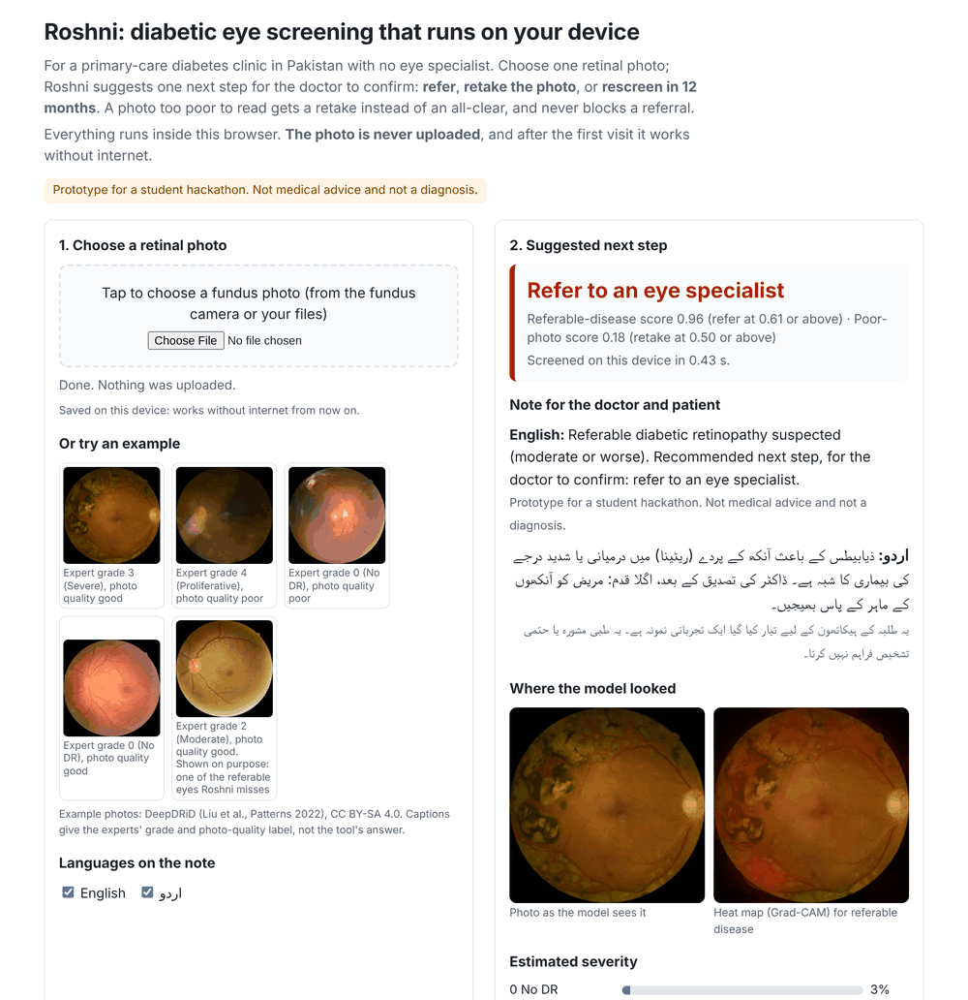

# Roshni: open, offline diabetic eye triage for primary-care clinics in Pakistan

**Track:** Health
**Team:** Varun Bajpai (India), Laziza Farrukhovna (Uzbekistan), Zainab Jamshed (Pakistan)
**Try it:** [TEAM_TO_WRITE(demo_link): link to the browser demo, e.g. https://USERNAME.github.io/roshni/web/] · **Code:** [TEAM_TO_WRITE(repo_link): link to the public GitHub repository]

> This project is a prototype and is not medical advice.

**Main takeaway:** Roshni ranks disease well at unseen hospitals (AUC [FROM_RESULTS_JSON: results.external_all.AUC | .3f]), but each clinic must re-set its cut-off locally, which an open tool allows.

<!-- Generated from README.template.md by fill_report.py. Edit the template, not this file. Numbers come only from results/. -->

## The problem
<!-- team:problem -->Pakistan has the world's highest diabetes prevalence: 31.4% of adults, about 34.5 million people, and in Pakistani studies about 29% of people with diabetes had diabetic retinopathy (9% sight-threatening). It is treatable if caught early, but Pakistan has about 15 ophthalmologists per million people, mostly in cities (high-income countries: 76). Screening is not available at primary level, travel to city hospitals is costly and harder for women, and surveyed eye hospitals had no screening policy.<!-- /team:problem -->

## What we built
**User:** a doctor or nurse in a Pakistani primary-care diabetes clinic with a retinal camera but no eye specialist. **In:** one retinal photo. **Out:** one next step for the doctor to confirm: **REFER** (moderate or worse, grade 2 to 4), **RETAKE** (too unclear to rule disease out) or **RESCREEN** in 12 months.
**Safety rule:** a photo judged too poor to read gets a retake instead of an all-clear, and never blocks a referral. It also shows the estimated grade, a heat map and a note in English and Urdu.

## What we added
Our own idea (track 4.1.4).

- **What already exists:** FDA-cleared LumineticsCore and EyeArt, and Medios AI (offline, smartphone camera, India): all commercial and closed (appendix); UK estimates for AI graders were GBP 0.35 to 3.02 per patient (NICE 2021).
- **What we add:** an open, safety-first version anyone can re-test: thresholds frozen before testing, failures published, a retake rule that never blocks a referral, a pre-planned stress test, and a browser demo that keeps the photo on the device and works offline ([FROM_RESULTS_JSON: derived.cpu_short]).
- **Own question:** does the photo-quality check stop false all-clears? On [FROM_RESULTS_JSON: derived.val_photos | int] external photos, referable photos given an all-clear fell from [FROM_RESULTS_JSON: workflow.without_quality_gate.referable_given_all_clear | int] to [FROM_RESULTS_JSON: workflow.with_quality_gate.referable_given_all_clear | int] (severe or proliferative: [FROM_RESULTS_JSON: workflow.without_quality_gate.sight_threatening_given_all_clear | int] to [FROM_RESULTS_JSON: workflow.with_quality_gate.sight_threatening_given_all_clear | int]), costing [FROM_RESULTS_JSON: workflow.with_quality_gate.RETAKE | int] retakes.
- **New source:** trained on rural India (APTOS 2019), tested once on unseen Chinese hospital photos (DeepDRiD).

## How it works
- **Data:** APTOS 2019, 3,662 photos graded 0 to 4 (Aravind Eye Hospital, India), split by grade into [FROM_RESULTS_JSON: derived.split_counts], with [FROM_RESULTS_JSON: duplicates.pairs | int] near-duplicate pairs kept on one side of the split. External: [FROM_RESULTS_JSON: derived.ext_photos | int] DeepDRiD photos from [FROM_RESULTS_JSON: derived.ext_patients | int] patients with expert quality labels.
- **Model:** EfficientNet-B0 (ImageNet weights), fine-tuned for [FROM_RESULTS_JSON: derived.epochs_run | int] epochs at [FROM_RESULTS_JSON: frozen.size | int] px; referable score = probability of grade 2 or worse.
- **Frozen before testing:** the referral threshold ([FROM_RESULTS_JSON: frozen.ref_threshold | .3f]) was set for [FROM_RESULTS_JSON: frozen.target_sensitivity | pct0] sensitivity on validation; the quality check (logistic regression on image features, cut-off [FROM_RESULTS_JSON: frozen.poor_threshold | .2f]) was trained only on DeepDRiD's 1,200 training photos.
- **Baselines:** colour histogram, and untuned pretrained features, each + logistic regression, thresholded the same way.

## Results
Held-out APTOS test ([FROM_RESULTS_JSON: derived.aptos_test_n | int] photos, [FROM_RESULTS_JSON: derived.aptos_test_referable | int] referable) and external DeepDRiD:

[FROM_RESULTS_JSON: table.main]

- **By severity (APTOS test):** [FROM_RESULTS_JSON: derived.severe_sent | int] of [FROM_RESULTS_JSON: derived.severe_total | int] severe and [FROM_RESULTS_JSON: derived.prolif_sent | int] of [FROM_RESULTS_JSON: derived.prolif_total | int] proliferative photos were referred.
- **External photos:** at the frozen cut-off sensitivity fell to [FROM_RESULTS_JSON: results.external_all.sensitivity | pct] though AUC stayed [FROM_RESULTS_JSON: results.external_all.AUC | .3f]: the ranking carried over, the cut-off did not. Re-set on about [FROM_RESULTS_JSON: derived.lc_photos | int] local labelled photos, it gave [FROM_RESULTS_JSON: derived.lc_sens | .1f]% sensitivity and [FROM_RESULTS_JSON: derived.lc_spec | .1f]% specificity (post-hoc; appendix).
<!-- if:v2 -->- **v2, more cameras (pre-registered):** adding [FROM_RESULTS_JSON: v2.oiaddr.photos | int] photos from 147 hospitals raised DeepDRiD sensitivity to [FROM_RESULTS_JSON: v2.results.external_all.sensitivity | pct] (false all-clears [FROM_RESULTS_JSON: workflow.with_quality_gate.referable_given_all_clear | int] → [FROM_RESULTS_JSON: v2.workflow.with_quality_gate.referable_given_all_clear | int]) but cut specificity to [FROM_RESULTS_JSON: v2.results.external_all.specificity | pct], with [FROM_RESULTS_JSON: derived.v2_near_copies | int] near-copies of DeepDRiD photos among them: [FROM_RESULTS_JSON: derived.v2_verdict] (appendix).<!-- /if:v2 -->
- **Worse photos (stress test):** [FROM_RESULTS_JSON: derived.stress_brief] (appendix).
- **Where it fails:** [TEAM_TO_WRITE(where_it_fails): two missed eyes from results/missed_external.png (or the team-only APTOS gallery) and the reason you see in each, e.g. blur, small lesions near the edge, or a grade you would dispute]
- **What we learned:** [TEAM_TO_WRITE(what_we_learned): two or three sentences on what surprised you, e.g. how the external photos, the poor-quality photos or the stress test changed what you believed, and what you would do differently]

**Limitations.** Not tested on Pakistani patients or low-cost cameras; the stress test only imitates worse photos. APTOS grades come from single graders. Unlike commercial tools, we do not detect macular oedema, use one photo per eye and have no prospective trial. No age or sex is recorded; sensitivity differs by hospital source (appendix).

## What we'd do next
<!-- team:next_steps -->1. Test the frozen tool on the expert-graded Pakistani dataset registered at Al-Ibrahim Eye Hospital, Karachi (50,000 patients planned, NCT06287645), then in a primary-care clinic that already screens.
2. Test it with the low-cost cameras such clinics can afford, and ask doctors and camera operators whether the three actions and the Urdu note fit their routine.<!-- /team:next_steps -->

## Sources
- IDF Diabetes Atlas, Pakistan: https://diabetesatlas.org/data-by-location/country/pakistan
- Mumtaz et al. 2018, diabetic retinopathy in Pakistan, systematic review: https://pjms.com.pk/index.php/pjms/article/view/13819
- Ophthalmologists per million in Pakistan (The News, 2026): https://www.thenews.pk/print/1422954-rising-cataract-burden-outpaces-pakistan-s-healthcare-capacity
- Sightsavers 2021, diabetic retinopathy services in Pakistan (primary level, cities, barriers for women): https://www.sightsavers.org/blogs/2021/06/diabetic-retinopathy-in-pakistan
- Shah et al. 2019, screening policy in Pakistani eye hospitals: https://www.ijo.cn/gjyken/article/pdf/20190517
- Siddiqui, Zafar and Qazi 2023, AI and the future of healthcare in Pakistan (J Pak Med Assoc): https://jpma.org.pk/index.php/public_html/article/view/10917/2701
- Pakistan public primary-care spending (World Bank, Health Financing System Assessment): https://openknowledge.worldbank.org/bitstreams/716ee589-8e2b-4c9c-9759-b2d45c68ee01/download
- Barriers to eye care in Pakistan (Malik et al. 2025): https://www.ncbi.nlm.nih.gov/pmc/articles/PMC12260732/
- Pakistani expert-graded retinal dataset registered on ClinicalTrials.gov (NCT06287645; site: Al-Ibrahim Eye Hospital, Karachi): https://clinicaltrials.gov/study/NCT06287645
- NICE MIB265 (2021), AI technologies for detecting diabetic retinopathy (cost per patient): https://www.nice.org.uk/advice/mib265/chapter/summary
- Jawa et al. 2016, integrated primary-care model for DR detection in Pakistan (Pak J Med Sci; cites the 223-patient clinic study): https://pjms.com.pk/index.php/pjms/article/view/10955
- Ahsan et al. 2021, one-window diabetes eye care facility at Al-Ibrahim Eye Hospital (Pak J Med Sci): https://pjms.org.pk/index.php/pjms/article/download/3946/1100
- Topcon TRC-NW400 camera about US$15,000 to 22,000; IDx-DR per-image fee not public (AAFP 2020): https://www.aafp.org/pubs/afp/issues/2020/0301/p307.html
- Google's Thailand deployment (MIT Technology Review 2020): https://www.technologyreview.com/2020/04/27/1000658/google-medical-ai-accurate-lab-real-life-clinic-covid-diabetes-retina-disease/amp/ and (TechCrunch 2020): https://techcrunch.com/2020/04/27/google-medical-researchers-humbled-when-ai-screening-tool-falls-short-in-real-life-testing/
- LumineticsCore (IDx-DR) FDA 510(k) summary K203629: https://www.accessdata.fda.gov/cdrh_docs/pdf20/K203629.pdf
- EyeArt FDA 510(k) summary K200667: https://www.accessdata.fda.gov/cdrh_docs/pdf20/K200667.pdf
- LumineticsCore pivotal trial (Abramoff et al. 2018): https://www.nature.com/articles/s41746-018-0040-6
- EyeArt pivotal trial (Ipp et al. 2021): https://pubmed.ncbi.nlm.nih.gov/34779843/
- Medios AI, offline smartphone screening in India (Natarajan et al., JAMA Ophthalmology 2019): https://pubmed.ncbi.nlm.nih.gov/31393538/ and in Dominica (Kemp et al., BMJ Open Ophthalmology 2023): https://bmjophth.bmj.com/content/8/1/e001491
- APTOS 2019 Blindness Detection: https://www.kaggle.com/c/aptos2019-blindness-detection
- DeepDRiD (Liu et al., Patterns 2022): https://github.com/deepdrdoc/DeepDRiD
- Pretrained model: EfficientNet-B0 with ImageNet weights (torchvision `IMAGENET1K_V1`): https://docs.pytorch.org/vision/stable/models/generated/torchvision.models.efficientnet_b0.html; EfficientNet paper (Tan and Le 2019): https://arxiv.org/abs/1905.11946
- Grad-CAM (Selvaraju et al. 2017): https://arxiv.org/abs/1610.02391
- Libraries: PyTorch https://pytorch.org, scikit-learn https://scikit-learn.org, pandas https://pandas.pydata.org, Pillow https://python-pillow.org, matplotlib https://matplotlib.org, Gradio https://www.gradio.app, ONNX Runtime and ONNX Runtime Web https://onnxruntime.ai
- AI tools: [TEAM_TO_WRITE(ai_tools): every assistant used, e.g. Claude (Anthropic) for code and research support]

---

## Appendix: technical details

**How this maps to the judging criteria**

| Criterion | Evidence in this project |
|---|---|
| Technical quality | Two baselines; threshold frozen on validation; held-out test; untouched external set from another country with patient-level confidence intervals; a stress test planned before results; missed cases and false alarms reported separately |
| Impact | A named user and moment in Pakistani primary care; three actions a clinic can act on; verified diabetes and eye-workforce figures for Pakistan; a demo that runs on the devices a clinic already has |
| Creativity | A proven screening workflow rebuilt in the open, with a retake rule that cuts false all-clears but never blocks a referral, tested on deliberately worse photos; a note in Urdu as well as English |
| Clarity | A screenshot and one main takeaway at the top; three actions (refer, retake, rescreen); a two-minute video of the real demo; every number generated from `results/` |

**What already exists, and where Roshni differs** (from FDA summaries and published studies; their accuracy comes from prospective studies, ours from public photos)

| | LumineticsCore (IDx-DR) | EyeArt | Medios AI | Roshni |
|---|---|---|---|---|
| Who takes the photo | Primary-care staff | Primary-care or eye-care staff | A minimally trained health worker | Primary-care doctor or nurse |
| Camera | 2 photos per eye, Topcon NW400 only | 2 photos per eye, named Canon cameras | Remidio smartphone-based camera | 1 photo, no camera model required; not yet tested on low-cost cameras |
| Referral line | More than mild DR, including macular oedema | Moderate or worse, or macular oedema | More than mild DR, with or without macular oedema | Moderate or worse (grade 2 to 4); no macular oedema |
| Poor photo | "Insufficient image quality" | "Ungradable" | Not stated in the studies we read | Retake, or refer if disease is already visible |
| Where it runs | Remote servers | Remote servers | Offline, on the camera's smartphone | A web browser, offline after the first visit; or a CPU alone ([FROM_RESULTS_JSON: derived.cpu_short]) |
| Code and model | Commercial | Commercial | Proprietary | Open |
| Evidence | Prospective trial: 900 patients, 10 primary-care sites | Prospective trial: 893 patients, 15 sites | 213 participants in India (sensitivity 100%, specificity 88.4%); in real-world use in Dominica, 77.5% and 91.5% | Retrospective: held-out and external public photos, plus a stress test; not tested in Pakistan |

<!-- team:adoption --><!-- /team:adoption -->

**Context, not head-to-head:** in prospective trials graded by a reading centre and covering macular oedema, LumineticsCore reported 87.2% sensitivity and 90.7% specificity (900 patients) and EyeArt 95.5% and 85.0% (893 patients).

**What a clinic needs to run it**

| Need | Roshni |
|---|---|
| Device | A phone or computer with a current web browser (tested in Chrome) |
| Internet | Only for the first visit, about 31 MB (model 16 MB + ONNX Runtime 15 MB); after that it works with the network switched off (tested) |
| Photo | One retinal photo (JPEG or PNG) from any fundus camera |
| Server, account, licence fee, graphics card | None |
| Speed | [FROM_RESULTS_JSON: derived.cpu_sentence]; the browser demo shows the time on each device |

**Why each design choice (evidence behind it)**

| Choice | Evidence |
|---|---|
| Refer, retake, or rescreen in 12 months | LumineticsCore's outputs and 12-month advice |
| A photo too poor to read is retaken, not cleared, and never blocks a referral | Google's Thailand deployment rejected more than a fifth of photos and left patients waiting; EyeArt could not grade 12.6% of undilated eyes |
| Runs in a browser or on a CPU, offline | Internet outages halved screening at one Thai clinic; Pakistan's public primary-care spending is about US$16 per person |
| One photo, any camera, no licence fee | LumineticsCore needs a US$15,000 to 22,000 Topcon camera and two photos per eye, with a per-image fee that is not public; Medios is tied to Remidio's camera |
| Open, frozen thresholds | No public expert-graded Pakistani dataset yet, so a local clinic must be able to re-test the tool itself |
| Urdu note | Illiteracy and female gender are documented barriers to eye care in Pakistan |

**Stress test (planned before any result).** Every held-out APTOS test photo and every DeepDRiD validation photo was made worse in four fixed ways, at two strengths: blur (Gaussian radius 1.5 and 3 px), lower resolution (shrunk to 192 and 96 px, then enlarged back), under-exposure (brightness ×0.6 and ×0.35), and messaging-app compression (JPEG quality 30 and 8). The frozen tool was scored on each copy without re-tuning anything. It imitates worse photos; it is not a test on real low-cost cameras. Result: [FROM_RESULTS_JSON: derived.stress_sentence]. See `results/stress_test.png` and `results/stress_examples.png`.

[FROM_RESULTS_JSON: table.stress]

**External results by photo quality and hospital source (DeepDRiD).** Sensitivity was [FROM_RESULTS_JSON: results.external_good_photos.sensitivity | pct] on good photos and [FROM_RESULTS_JSON: results.external_poor_photos.sensitivity | pct] on poor ones. It does not perform equally across hospital sources: sensitivity ranged from [FROM_RESULTS_JSON: derived.src_sens_min | .1f]% to [FROM_RESULTS_JSON: derived.src_sens_max | .1f]% (two of the three sources are small).

[FROM_RESULTS_JSON: table.by_source]

**APTOS test, by grade** (five-grade agreement, quadratic weighted kappa: [FROM_RESULTS_JSON: aptos_grades.QWK | .3f])

[FROM_RESULTS_JSON: table.by_grade]

**Workflow with and without the quality check ([FROM_RESULTS_JSON: derived.val_photos | int] DeepDRiD validation photos)**

[FROM_RESULTS_JSON: table.workflow]

<!-- if:v2 -->**v2: more cameras in training (pre-registered).** The plan, the tests and the decision rule were committed to GitHub (`PREREGISTRATION_v2.md`) before v2 was trained. v2 is the same pipeline with the OIA-DDR grading photos (Li et al. 2019; [FROM_RESULTS_JSON: v2.oiaddr.photos | int] gradable photos from 147 hospitals in China, 42 camera models; CC BY-NC-SA 4.0) added to training and validation, split the same near-duplicate-safe way ([FROM_RESULTS_JSON: v2.oiaddr.split.train | int] / [FROM_RESULTS_JSON: v2.oiaddr.split.val | int] / [FROM_RESULTS_JSON: v2.oiaddr.split.test | int]). Its referral cut-off ([FROM_RESULTS_JSON: v2.frozen.ref_threshold | .3f]) was frozen on the combined validation photos. More camera variety closed most of the missed-referral gap on the unseen hospitals but cost specificity, and the hash check found [FROM_RESULTS_JSON: derived.v2_near_copies | int] DeepDRiD photos with near-copies among the added photos (removing them changes little). Verdict: [FROM_RESULTS_JSON: derived.v2_verdict]. Both OIA-DDR and DeepDRiD are from China, so neither model is shown to work in Pakistan. Files: `results_v2/`, `Roshni_v2_OIA-DDR.ipynb`.

[FROM_RESULTS_JSON: table.v2_compare]

[FROM_RESULTS_JSON: table.v2_tests]<!-- /if:v2 -->

**Re-setting the cut-off locally (added after seeing the external result; the frozen results above stay the main ones).** We drew a "clinic sample" of DeepDRiD training patients (whole patients, all their photos), set the referral cut-off for [FROM_RESULTS_JSON: frozen.target_sensitivity | pct0] sensitivity on it with the same function used to freeze the original, and scored the full workflow on the 400 validation photos from [FROM_RESULTS_JSON: derived.lc_eval_patients | int] other patients; the grading model never saw any DeepDRiD photo. Over [FROM_RESULTS_JSON: derived.lc_draws | int] random samples of [FROM_RESULTS_JSON: derived.lc_patients | int] patients: sensitivity [FROM_RESULTS_JSON: derived.lc_sens | .1f]% (10th to 90th percentile [FROM_RESULTS_JSON: derived.lc_sens_range]) instead of [FROM_RESULTS_JSON: derived.lc_frozen_sens | .1f]%, specificity [FROM_RESULTS_JSON: derived.lc_spec | .1f]% ([FROM_RESULTS_JSON: derived.lc_spec_range]) instead of [FROM_RESULTS_JSON: derived.lc_frozen_spec | .1f]%; referable photos given an all-clear [FROM_RESULTS_JSON: derived.lc_allclear | int] instead of [FROM_RESULTS_JSON: derived.lc_frozen_allclear | int] (severe or proliferative: [FROM_RESULTS_JSON: derived.lc_sev_allclear | int]), at the cost of [FROM_RESULTS_JSON: derived.lc_refer | int] referrals instead of [FROM_RESULTS_JSON: derived.lc_frozen_refer | int]. The same hospitals supply both sets, so this shows the procedure works, not that one cut-off fits every clinic. See `results/local_calibration.png` and `local_calibration.py`.

**Two photos per eye (added after seeing the external result; nothing re-trained or re-tuned).** DeepDRiD has two photos of every eye, as LumineticsCore and EyeArt ask for. Referring an eye when either of its photos scores at or above the frozen cut-off raised sensitivity on the unseen hospitals from [FROM_RESULTS_JSON: derived.tp_one_sens | .1f]% per photo to [FROM_RESULTS_JSON: derived.tp_two_sens | .1f]% per eye ([FROM_RESULTS_JSON: derived.tp_eyes | int] eyes of [FROM_RESULTS_JSON: derived.tp_patients | int] patients; 95% interval [FROM_RESULTS_JSON: derived.tp_two_ci | str], resampling patients), while specificity went from [FROM_RESULTS_JSON: derived.tp_one_spec | .1f]% to [FROM_RESULTS_JSON: derived.tp_two_spec | .1f]%. On the [FROM_RESULTS_JSON: derived.tp_val_eyes | int] validation eyes, taking the more cautious of the two decisions left [FROM_RESULTS_JSON: derived.tp_val_allclear | int] referable eyes with an all-clear (severe or proliferative: [FROM_RESULTS_JSON: derived.tp_val_sev | int]) but sent [FROM_RESULTS_JSON: derived.tp_val_retake | int] eyes to a retake. The unit changes from photos to eyes, so this points to a clinic protocol (two photos per eye) rather than replacing the frozen results. See `two_photo.py`.

**Pictures that are not retinal photos.** Roshni has no separate "is this a retina?" check, so we screened [FROM_RESULTS_JSON: derived.nr_n | int] non-retinal pictures (plain and noisy images, a page of text, a chart, everyday photos): [FROM_RESULTS_JSON: derived.nr_allclear_words | str] got an all-clear; [FROM_RESULTS_JSON: derived.nr_retake | int] were sent to a retake and [FROM_RESULTS_JSON: derived.nr_refer | int] to a referral (a wasted referral, not a missed one). See `non_retinal_check.py`.

**Against a real-world bar.** LumineticsCore's pivotal trial fixed its targets in advance: sensitivity above 85% and specificity above 82.5% (it reached 87.2% and 90.7%; Abramoff et al. 2018). Its reference standard, unit and patients differ from ours, so this is a yardstick, not a head-to-head test. [FROM_RESULTS_JSON: derived.bar_met_words | str], which is why Roshni stays a research prototype and why the next step is a local test with targets fixed in advance.

[FROM_RESULTS_JSON: table.bar]

**Photo-quality check:** found poor photos with AUC [FROM_RESULTS_JSON: quality_gate.AUC_detecting_poor_photos | .3f]; flags [FROM_RESULTS_JSON: quality_gate.poor_photos_flagged | pct] of poor photos and [FROM_RESULTS_JSON: quality_gate.good_photos_flagged | pct] of good ones ([FROM_RESULTS_JSON: quality_gate.flagged_share | pct] of all photos sent to retake or refer on quality).

**External AUC interval** resampling whole patients (each has up to four photos): [FROM_RESULTS_JSON: results.external_all.AUC_CI_by_patient | ci].

**Code and how to run**

| File | What it is |
|---|---|
| `Roshni_Results.ipynb` | **Start here.** Saved with its outputs: recomputes every number above from the per-photo predictions, runs the trained model on the demo photos with heat maps, checks the browser model against PyTorch, and (with DeepDRiD downloaded) re-scores the 400 external validation photos. Runs on a CPU in minutes |
| `Roshni_DR_Screening.ipynb` | The full training run on a free Kaggle GPU (the experiment itself ran in [FROM_RESULTS_JSON: derived.run_minutes | int] minutes): data, near-duplicate split, baselines, training, frozen thresholds, external test, quality check, stress test, CPU timing, web export |
| `drscreen.py` | The core: preprocessing, model, metrics, the decision rule, stress-test changes, Grad-CAM, the English and Urdu note |
| `run_dr.py` | The experiment, end to end; writes everything in `results/` |
| `PREREGISTRATION_v2.md`, `Roshni_v2_OIA-DDR.ipynb` | v2: the same pipeline with the OIA-DDR photos (147 hospitals, 42 camera models) added to training, with its success tests fixed and committed before it was run |
| `local_calibration.py` | Re-setting the cut-off on a small local sample (added after the external result; needs no GPU) |
| `two_photo.py`, `non_retinal_check.py` | Two photos per eye, and pictures that are not retinal photos (both added after the main results; the second needs the model, no GPU) |
| `results/` | Outputs of the run: `results.json`, per-photo predictions, the model (`model_best.pt`) and quality check (`quality_gate.pkl`), figures (no APTOS photos) |
| `story/` | A one-page scroll story of the project that links to the demo (no outside requests; numbers from `results/`) |
| `web/` | The browser demo (ONNX Runtime Web; works offline after the first visit); `export_web.py` builds it from the run |
| `app.py` | An optional Gradio version of the demo |
| `fill_report.py`, `README.template.md` | Writes this README from `results/` so no number is typed by hand; `check_submission.py` checks it against the rules |
| `tests/` | Unit tests (`pytest -q tests`) and browser checks |

**Reproduce:** open `Roshni_DR_Screening.ipynb` on Kaggle (APTOS 2019 attached, GPU and Internet on) and run all; then `python fill_report.py`. To check the results without a GPU: `pip install -r requirements.txt`, then run `Roshni_Results.ipynb`.

**Licences:** our code is MIT (`LICENSE`). The demo photos in `web/examples` and the screenshot in `docs/` are from DeepDRiD (CC BY-SA 4.0, Liu et al. 2022). ONNX Runtime Web is MIT (`web/ort/NOTICE.md`). No APTOS image is included, following the competition's rules; the trained weights were fit on APTOS 2019 data, so check those rules before using them beyond research. v2's added training data (OIA-DDR) is CC BY-NC-SA 4.0, non-commercial. Roshni is a research prototype: not a medical device, not registered with Pakistan's drug regulator (DRAP), and not for decisions about real patients.
